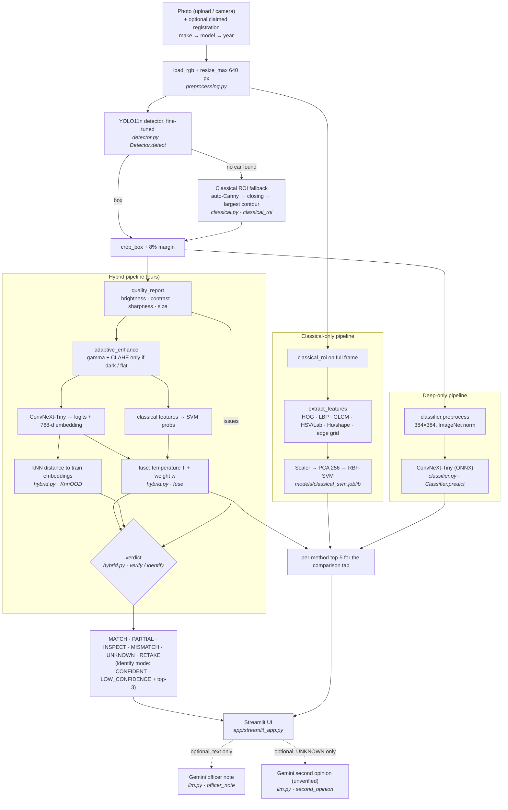
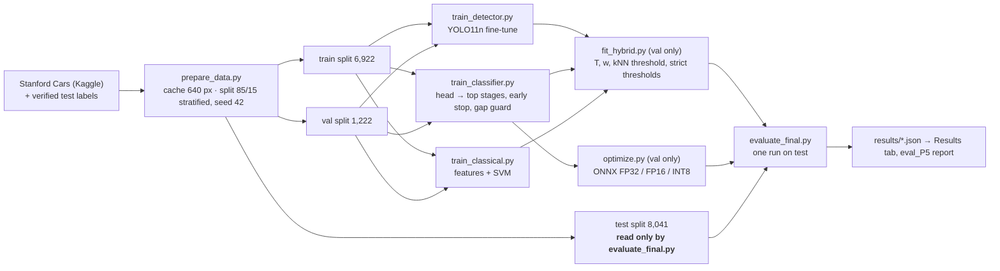

# VeriCar - system architecture

Every box names the module (and function) that implements it, so the diagram can be checked against the code.

## Inference: `VeriCar.analyze(image, claim=None)` in `vericar/pipeline.py`

## Offline: training, fitting and evaluation (`scripts/`)

