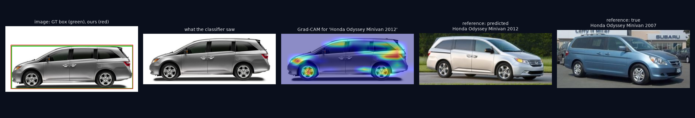
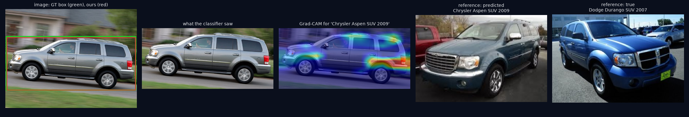
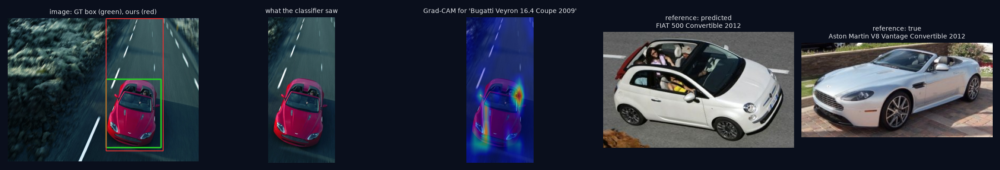
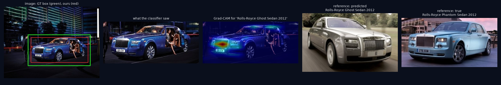
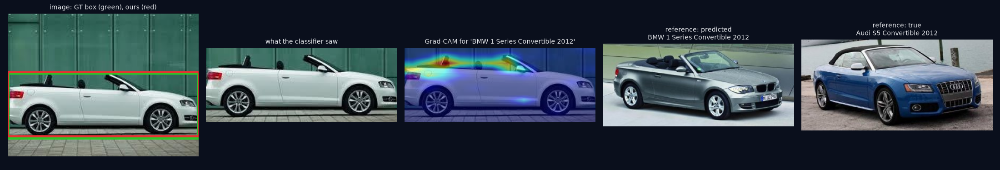

USN1,USN2,USN3,USN4

# Evaluation results - P5 (Team TXX): VeriCar

Official Stanford Cars test set, **8,041 images, evaluated once** after all parameters were frozen on an 85/15 stratified train/validation split (seed 42) of the official training set. Robustness uses a fixed random 1,000-image test subset.

## 1. Classification performance (Top-1 / Top-5)

| Method | Top-1 | Top-5 | Make acc. | Model acc. | Year acc. given correct model |
|---|---|---|---|---|---|
| Classical (contour ROI + HOG/LBP/GLCM/colour/geometry + SVM) | 5.66% | 15.27% | 14.86% | 5.91% | 96.40% |
| Deep (YOLO crop + ConvNeXt-T) | 93.41% | 99.18% | 97.84% | 93.98% | 99.40% |
| Hybrid (ours) | 93.40% | 99.18% | 97.80% | 93.96% | 99.40% |
| Reference: ConvNeXt-T on ground-truth crop | 93.43% | 99.22% | 97.75% | 93.98% | 99.44% |

Classical model selection and feature-family ablation (validation split):

| Variant | Top-1 | Top-5 |
|---|---|---|
| SVM-RBF C=3 | 21.28% | 41.73% |
| SVM-RBF C=10 | 21.28% | 41.73% |
| RandomForest-500 | 9.33% | 20.87% |
| without hog | 8.35% | 21.44% |
| without texture | 20.05% | 40.92% |
| without colour | 20.21% | 41.08% |
| without geometry | 20.95% | 41.65% |

## 2. Object localisation (IoU) and 3. Object detection (mAP)

| Detector | Mean IoU | IoU >= 0.5 | IoU >= 0.75 | mAP@0.5 | mAP@0.5:0.95 | Miss rate |
|---|---|---|---|---|---|---|
| YOLO11n fine-tuned (ours) | 0.953 | 99.81% | 98.97% | 0.990 | 0.933 | 0.01% |
| YOLO11n COCO-pretrained | 0.871 | 91.52% | 90.49% | 0.855 | 0.782 | 0.11% |
| Classical edges+contours | 0.654 | 79.63% | 31.70% | 0.640 | 0.226 | 0.00% |

## 4. Model efficiency (size and inference time)

Classifier variants; latency = median of 30 single-image runs on CPU limited to 2 threads; accuracy on validation ground-truth crops. Shipped variant: **onnx_fp32** (fastest variant with val top-1 >= ONNX FP32 - 0.005).

| Variant | Size (MB) | Latency (ms) | Val Top-1 |
|---|---|---|---|
| onnx_fp32 | 112.0 | 346 | 93.50% |
| onnx_fp16 | 56.4 | 400 | 93.50% |
| onnx_int8_dynamic | 28.4 | 348 | 92.75% |
| onnx_int8_static | 28.7 | 85 | 85.00% |

End-to-end deployed pipeline (`VeriCar.analyze`, ONNX FP32 classifier, YOLO on CPU), median over 20 test images, ms:

| Stage | ms |
|---|---|
| load | 4 |
| detect | 69 |
| classical | 22 |
| deep | 96 |
| hybrid | 7 |
| total | 202 |

Notes:

- Latency: median single-image CPU time, ONNX Runtime limited to 2 threads (free-host proxy), idle machine.
- Static INT8 (min-max calibration on 128 train crops) is 4x faster but loses 8.5 points: ConvNeXt activations after LayerNorm/GELU have outliers that min-max calibration clips. Percentile calibration / keeping LayerNorm in FP32 is future work.
- Dynamic INT8 quarters the size but gives no speed-up on this CPU (integer depthwise kernels).
- FP16 halves the size with identical accuracy but is slightly slower on CPUs without native FP16 math.

## 5. Robustness (performance under varying conditions)

| Condition | Classical | Deep | Hybrid | Hybrid RETAKE rate | Box IoU |
|---|---|---|---|---|---|
| clean | 5.40% | 93.60% | 93.60% | 0.30% | 0.953 |
| dark (x0.35) | 1.60% | 93.50% | 90.40% | 24.20% | 0.950 |
| bright (x1.6) | 4.80% | 92.90% | 92.90% | 0.20% | 0.950 |
| low contrast (x0.4) | 3.00% | 92.90% | 93.10% | 2.50% | 0.951 |
| occlusion 10% | 4.20% | 91.70% | 91.70% | 0.30% | 0.935 |
| occlusion 25% | 1.90% | 85.30% | 85.20% | 0.60% | 0.797 |
| occlusion 40% | 1.50% | 76.00% | 75.80% | 2.70% | 0.658 |
| low-res 1/4 | 3.80% | 79.30% | 79.20% | 76.60% | 0.938 |
| low-res 1/8 | 1.40% | 38.90% | 38.90% | 99.90% | 0.899 |
| blur sigma 2 | 3.70% | 84.20% | 84.20% | 92.20% | 0.939 |
| blur sigma 4 | 1.60% | 50.90% | 50.90% | 99.90% | 0.895 |
| noise sigma 20 | 4.40% | 91.40% | 91.40% | 1.30% | 0.930 |

Viewing-angle proxy (box width/height; Stanford Cars has no pose labels):

| View | n | Classical | Deep | Hybrid |
|---|---|---|---|---|
| front/rear-ish (w/h < 1.4) | 835 | 5.63% | 89.82% | 89.82% |
| three-quarter (1.4-1.9) | 3467 | 6.09% | 94.64% | 94.66% |
| side-ish (>= 1.9) | 3739 | 5.27% | 93.02% | 92.97% |

## 6. Confidence and threshold analysis

Temperature scaling T = 0.60 (validation). ECE: deep 0.145, hybrid 0.012.

| Confidence threshold | Coverage | Accuracy of answered |
|---|---|---|
| 0.00 | 100.00% | 93.37% |
| 0.10 | 100.00% | 93.37% |
| 0.20 | 99.81% | 93.51% |
| 0.30 | 99.34% | 93.77% |
| 0.40 | 98.66% | 94.13% |
| 0.50 | 97.25% | 94.74% |
| 0.60 | 95.01% | 95.62% |
| 0.70 | 92.55% | 96.43% |
| 0.80 | 89.55% | 97.13% |
| 0.90 | 84.34% | 97.95% |

At the default identify threshold 0.49: coverage 97.43%, accuracy 94.66%; below it the app shows the top-3, which contain the true class 72.95% of the time.

### Claim verification (our use case)

| Claim type | MATCH (cleared) | PARTIAL | INSPECT | MISMATCH | UNKNOWN | RETAKE |
|---|---|---|---|---|---|---|
| legit | 82.91% | 1.42% | 7.76% | 1.09% | 6.47% | 0.35% |
| hard_clone | 1.68% | 2.82% | 14.82% | 73.86% | 6.47% | 0.35% |
| easy_clone | 0.00% | 0.00% | 0.07% | 93.11% | 6.47% | 0.35% |

Hard-clone catch rate **98.32%**, easy-clone catch rate 100.00%, false-alarm rate on legitimate claims 17.09% (strict policy, thresholds fixed on validation).

Cars outside the dataset: 64.00% of 25 modern-car photos flagged UNKNOWN; AUROC kNN 0.950 vs max-softmax 0.958; in-dataset test flag rate 6.60%.

### Open-set fallback (POST-HOC: added after the test run, not part of the frozen system above)

OpenCLIP ViT-B-32 (laion2b_s34b_b79k), zero-shot, image encoder ONNX INT8; vocabulary of 196 known + 343 post-2012 names. Threshold on validation flags 3.03% of known cars. On 25 modern-car photos: kNN alone 64.00%, open-set alone 60.00%, **combined 92.00% flagged NOT IN RECORDS**; suggested name top-1 16.00%, top-3 52.00% (shown as unverified only).

## 7. Ablation study (test set)

| Variant | Top-1 | ECE | Hard-clone catch | False alarms |
|---|---|---|---|---|
| Full hybrid | 93.40% | 0.012 | 98.32% | 17.09% |
| - adaptive preprocessing | 93.41% | 0.011 | 98.32% | 17.04% |
| - YOLO ROI crop (full frame) | 92.19% | 0.014 | 98.40% | 23.99% |
| - classical feature fusion (w=0) | 93.40% | 0.012 | 98.32% | 17.09% |
| - temperature calibration (T=1) | 93.40% | 0.145 | 99.27% | 42.58% |
| - quality gate & unknown check | 93.40% | 0.012 | 98.23% | 13.93% |

Training log (anti-overfitting evidence):

| Stage | Epoch | Train top-1 (aug.) | Train top-1 (clean) | Val top-1 | Val loss | Gap (pts) |
|---|---|---|---|---|---|---|
| head | 1 | 9.20% | 34.70% | 25.20% | 3.662 | -16.0 |
| head | 2 | 33.00% | 58.84% | 43.70% | 3.112 | -10.7 |
| head | 3 | 47.12% | 67.10% | 48.28% | 2.994 | -1.2 |
| top | 1 | 42.26% | 81.42% | 68.33% | 1.325 | -26.1 |
| top | 2 | 64.55% | 94.19% | 83.39% | 0.787 | -18.8 |
| top | 3 | 77.88% | 97.63% | 85.52% | 0.621 | -7.6 |
| top | 4 | 85.52% | 98.85% | 90.26% | 0.493 | -4.7 |
| top | 5 | 89.38% | 99.43% | 90.92% | 0.440 | -1.5 |
| top | 6 | 92.48% | 99.18% | 91.41% | 0.413 | +1.1 |
| top | 7 | 93.74% | 99.59% | 92.55% | 0.392 | +1.2 |
| top | 8 | 94.78% | 99.51% | 92.39% | 0.393 | +2.4 |
| top | 9 | 95.59% | 99.75% | 93.62% | 0.406 | +2.0 |
| top | 10 | 96.59% | 99.75% | 93.21% | 0.391 | +3.4 |
| top | 11 | 96.88% | 99.92% | 93.04% | 0.385 | +3.8 |
| top | 12 | 97.37% | 99.92% | 93.29% | 0.401 | +4.1 |
| top | 13 | 97.76% | 99.84% | 93.29% | 0.384 | +4.5 |
| top | 14 | 98.28% | 99.84% | 94.11% | 0.379 | +4.2 |
| top | 15 | 98.08% | 99.92% | 93.86% | 0.379 | +4.2 |
| top | 16 | 98.26% | 99.92% | 94.11% | 0.389 | +4.2 |
| top | 17 | 98.08% | 99.92% | 93.78% | 0.379 | +4.3 |
| top | 18 | 98.57% | 99.92% | 93.94% | 0.380 | +4.6 |

## 8. Failure cases

### Same model, wrong year
True: *Honda Odyssey Minivan 2007*. Predicted: *Honda Odyssey Minivan 2012* (100%).

**Cause: year-level look-alikes, and possibly a dataset label error.** The photo shows the 2011+ Odyssey design (the stepped 'lightning-bolt' window line), which is exactly what the 2012 reference shows; the 2007 reference has a straight beltline. Either the image is mislabelled in Stanford Cars or the year cue is too subtle. Grad-CAM spreads over the wheels and rear window line, i.e. the body shape. **What VeriCar does:** for a claim of a 2007 Odyssey this becomes PARTIAL/MISMATCH, so the officer checks documents.

### Confident, wrong make
True: *Dodge Durango SUV 2007*. Predicted: *Chrysler Aspen SUV 2009* (100%).

**Cause: badge engineering.** The Chrysler Aspen is a rebadged Dodge Durango: same body, doors, glasshouse and wheels. In a pure side view the only distinguishing part (the grille) is hidden, so even a 100%-confident model has nothing to separate them; Grad-CAM sits on the shared rear quarter and C-pillar. **Lesson:** confidence is not identity for twin vehicles; a front-view photo is needed. This pair is a natural 'hard clone' case for our verification study.

### Detector boxed the wrong region
True: *Aston Martin V8 Vantage Convertible 2012*. Predicted: *FIAT 500 Convertible 2012* (27%).

**Cause: unusual viewpoint + wrong ROI.** An aerial, top-down shot with motion blur; Stanford Cars training images are almost all ground-level side / three-quarter views. The detector's box (red) covers mostly road, so the crop the classifier sees is a tall strip that gets squashed to a square. Confidence is only 27%, and re-running the full app pipeline even returns a different class, so the prediction is unstable. **What VeriCar does:** low confidence means LOW_CONFIDENCE / INSPECT, never MATCH.

### Low light
True: *Rolls-Royce Phantom Sedan 2012*. Predicted: *Rolls-Royce Ghost Sedan 2012* (43%).

**Cause: same-make look-alikes under poor light and occlusion.** Rolls-Royce Phantom and Ghost share the grille, lamps and proportions; at night with glare and a person standing in the open door, the side profile (the main difference) is hidden. Grad-CAM focuses on the grille, which both models share. Confidence is 43%. **What VeriCar does:** below the MATCH bar the verdict is INSPECT, and the make level (Rolls-Royce) is still verified.

### Car cut off by the frame
True: *Audi S5 Convertible 2012*. Predicted: *BMW 1 Series Convertible 2012* (22%).

**Cause: truncated side view.** Both bumpers are cut off by the frame, so the grille and lamps that separate Audi from BMW are missing; Grad-CAM attends to the soft top and windscreen frame, which look alike across small convertibles. Confidence is only 22%. **What VeriCar does:** LOW_CONFIDENCE in identify mode (top-3 shown) and INSPECT for a verification claim.
